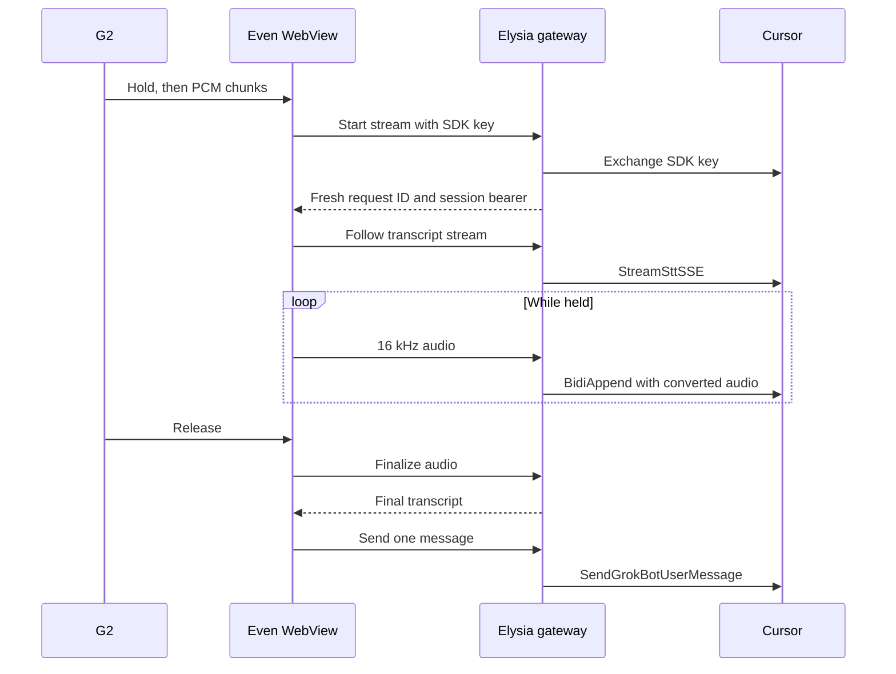

# Gateway integration

Grok Bot for Even G2 runs in the Even app's WebView. The G2 renders the HUD, emits gestures, and supplies microphone PCM. The WebView owns account selection, transcript state, and the recording lifecycle. Elysia forwards chat and dictation requests to Cursor. The gateway runs without a database or stored provider credentials. [EvenHub architecture](https://hub.evenrealities.com/docs/get-started/architecture)

The header inventory reflects source revision `02d5285`. The production streaming and idle-timeout checks were performed against gateway revision `a25fc5a`.

## Elysia plugin and workspace layout

The gateway package exports an Elysia instance named `gateway`. Mount it under the host's `/grokbot-gateway` prefix. A separate Bun entry point listens on port 3000 by default for the container image. The glasses app and gateway share wire types through `packages/protocol`. The npm package bundles the gateway's runtime code and uses the host's Elysia through a peer dependency. [Plugin usage](../packages/gateway/README.md) · [Standalone entry point](../packages/gateway/src/serve.ts)

Elysia leaves the POST body unread until the gateway applies the route's byte limit. The gateway counts the bytes read even when the client omits `Content-Length`. Gateway CORS and response headers apply to its own routes when mounted. The transcript route uses the host Bun server to set its 50-second request idle timeout. [Body limits](../packages/gateway/src/http.ts) · [Mount and header tests](../packages/gateway/tests/gateway.test.ts) · [Streaming tests](../packages/gateway/tests/cursor-stream.test.ts)

## Gateway-free feasibility

The phone can run the TypeScript for sign-in, RPC framing, audio conversion, and transcript handling. The current EHPK runs that code inside the Even app's browser engine. The EvenHub network whitelist grants permission to contact a host. The provider separately decides which WebView origins may make and read cross-origin requests through CORS. The Web SDK's documented bridge surface covers device functions and storage. It has no documented native HTTP relay. [EvenHub packaging and CORS](https://github.com/even-realities/everything-evenhub/blob/main/plugins/everything-evenhub/skills/build-and-deploy/SKILL.md#cors-in-the-webview) · [EvenHub device APIs](https://hub.evenrealities.com/docs/build/device-apis) · [Fetch CORS protocol](https://fetch.spec.whatwg.org/#http-cors-protocol)

### Provider checks on 2026-11-22

The checks sent only CORS preflights for the route matrix. The mobile WebKit follow-up made one read-only profile request from each origin with a synthetic invalid bearer. It used no user credential and sent no chat message or audio.

| Origin | Observed result |
| --- | --- |
| `null` | All 11 Cursor preflights returned HTTP 204 without `Access-Control-Allow-Origin`. This covered the SDK poll, key creation and exchange, profile, roster, transcript, send, transcript watch, both speech calls, and legacy link. Mobile WebKit's opaque-origin frame reported a fetch network error for the profile request. |
| `http://localhost:5173` | The same 11 preflights echoed this origin and allowed the requested headers. Mobile WebKit could read the profile endpoint's expected HTTP 401 for the invalid bearer. |
| `http://127.0.0.1:5173`, `http://localhost:49017`, and `https://example.com` | The Cursor profile preflight omitted `Access-Control-Allow-Origin` for each of these origins. CORS permission varied with the exact scheme, host, and port. |
| xAI Speech to Text from `null` and `http://localhost:5173` | The preflight returned wildcard origin and header allowances. A wildcard header allowance does not cover an explicit `Authorization` header under Fetch. [Fetch authorization header rule](https://fetch.spec.whatwg.org/#cors-non-wildcard-request-header-name) |

Reproduce the Cursor profile check by running this preflight with `Origin: null` and then with `Origin: http://localhost:5173`. Compare the origin allowance before interpreting the HTTP status. HTTP 204 alone does not establish CORS access.

```sh
curl -sS --max-time 10 -D - -o /dev/null -X OPTIONS \
  -H 'Origin: null' \
  -H 'Access-Control-Request-Method: POST' \
  -H 'Access-Control-Request-Headers: authorization,content-type,connect-protocol-version' \
  https://api2.cursor.sh/aiserver.v1.DashboardService/GetMe
```

### When WebKit skips preflight

WebKit can send same-origin requests and eligible cross-origin requests without an `OPTIONS` preflight. Eligible cross-origin requests use `GET`, `HEAD`, or `POST` with CORS-safelisted headers and a compatible body. A successful preflight can also be cached for matching requests. Even when WebKit skips `OPTIONS`, JavaScript still needs the provider's CORS permission to read a cross-origin response. [Fetch CORS protocol](https://fetch.spec.whatwg.org/#http-cors-protocol) · [Preflight cache](https://fetch.spec.whatwg.org/#cors-preflight-cache)

Direct Cursor requests from the G2 app use an `Authorization` header, JSON or Connect content types, or a Connect version header. Each can require a preflight. Setting fetch to `mode: 'no-cors'` restricts those headers and leaves JavaScript with an opaque response. The login, chat, and speech paths require readable responses. [Fetch header rules](https://fetch.spec.whatwg.org/#no-cors-safelisted-request-header) · [Opaque responses](https://fetch.spec.whatwg.org/#concept-filtered-response-opaque)

### Decision

A localhost development prototype is feasible at the browser transport layer. The actual origins of installed EHPKs on iOS and Android still need direct observation. Use the gateway for packaged builds until Cursor permits those origins or EvenHub offers a supported native HTTP transport. A direct implementation would also need to verify SDK sign-in, account discovery, text, and both speech routes from the installed app before replacing the gateway. [Manifest network permission](../apps/glasses/scripts/pack.mjs) · [Current WebView transport](../apps/glasses/src/client.ts)

A separate native phone app could make server calls through the OS networking stack. That option has a different distribution path and requires compatible Even device SDK access and approved Cursor credentials. The documented Even native device SDK uses Enterprise device licenses. [Even native SDK](https://hub.evenrealities.com/docs/enterprise/native)

## Sign-in and credentials

1. The WebView generates a one-time verifier and copies a Cursor SDK approval URL with its hash. The user pastes the URL into the phone browser while the dashboard waits. The gateway polls Cursor with the verifier and uses the returned login token to mint a 90-day personal SDK key. [Phone sign-in](../apps/glasses/src/cursor-login.ts) · [Gateway sign-in](../packages/gateway/src/cursor-login.ts) · [Cursor SDK authentication](https://cursor.com/docs/sdk/typescript#cursorauth)
2. EvenHub app-scoped storage on the phone holds each account's SDK key. Native reads and sends exchange that key for a short-lived Cursor bearer. The gateway returns a new speech request ID and the exchanged bearer when creating a voice stream. The WebView holds the streaming bearer in memory. [Gateway routes](../packages/gateway/src/index.ts) · [Phone storage and lifecycle](../apps/glasses/src/main.ts)
3. Starting in 0.1.10, the phone app uses the selected Cursor account for dictation and removes any old `speechKey` field when restoring accounts. The gateway's `/transcribe` route supports earlier builds that offered xAI speech. [Account restore and speech submission](../apps/glasses/src/session.ts) · [xAI Speech to Text](https://docs.x.ai/developers/model-capabilities/audio/speech-to-text)

## Current routes and headers

The table lists app-set headers and labels the generated multipart content type. JSON requests use `Accept: application/json`. Header names are case-insensitive. [Gateway request helpers](../packages/gateway/src/index.ts) · [Login request helper](../packages/gateway/src/cursor-login.ts)

| Job | Upstream request | Credential and headers |
| --- | --- | --- |
| Poll browser approval | `POST api2.cursor.sh/auth/poll` | JSON content type. The verifier is in the body. |
| Mint SDK key | `POST api2.cursor.sh/aiserver.v1.DashboardService/CreateUserApiKey` | Login access token as bearer, JSON content type, `Connect-Protocol-Version: 1`. |
| Exchange SDK key | `POST api2.cursor.sh/auth/exchange_user_api_key` | SDK key as bearer, JSON content type. |
| Profile | `POST api2.cursor.sh/aiserver.v1.DashboardService/GetMe` | Exchanged bearer, JSON content type, Connect version 1. |
| Account roster and message history | `POST api2.cursor.sh/aiserver.v1.GrokBotService/ListGrokBotAgents` and `ListGrokBotTranscriptEntries` | Exchanged bearer, JSON content type, Connect version 1. |
| Send a message | `POST api2.cursor.sh/aiserver.v1.GrokBotService/SendGrokBotUserMessage` | Exchanged bearer, JSON content type, Connect version 1. |
| Read live speech transcript | `POST api2.cursor.sh/aiserver.v1.AiService/StreamSttSSE` | Exchanged bearer, `Accept` and `Content-Type` both `application/connect+json`, Connect version 1. |
| Upload speech and control frames | `POST api2.cursor.sh/aiserver.v1.BidiService/BidiAppend` | Exchanged bearer, JSON content type, Connect version 1. |
| Older Cursor batch speech path | `POST api2.cursor.sh/aiserver.v1.AiService/TranscribeAudio` | Exchanged bearer, JSON content type, Connect version 1. |
| Legacy exact-name link and numeric chat sessions | `POST api.cursor.com/v0/grokbot/sessions`, `GET /v0/grokbot/sessions/:id/entries`, and `POST /v0/grokbot/sessions/:id/messages` | SDK key as bearer, `x-cursor-client-type: agent-serve`, a fresh `x-request-id` per request, and JSON content type on POST. |
| Legacy xAI batch speech | `POST api.x.ai/v1/stt` | xAI key as bearer. Fetch generates the multipart content type and boundary. |

The Bun runtime supplies the outbound user agent. A loopback audit with synthetic credentials verified the app-set headers and the runtime-generated headers independently. The three legacy calls explicitly opt in to their client-type and request-ID headers. Speech stream correlation uses a request ID in the body. [Legacy and streaming header tests](../packages/gateway/tests/gateway.test.ts) · [Streaming tests](../packages/gateway/tests/cursor-stream.test.ts) · [Bun fetch headers](https://bun.com/docs/runtime/networking/fetch#custom-headers)

## EvenHub whitelist review

The production EHPK for 0.1.10 declares `https://api.rayriffy.com` in its network whitelist. The WebView sends account, chat, and dictation requests to that origin under `/grokbot-gateway`. The gateway handles server-to-server calls to the providers. For sign-in, the app copies the Cursor approval URL for the user to open in their phone browser. The dashboard polls the gateway for completion. [Package manifest generation](../apps/glasses/scripts/pack.mjs) · [WebView requests](../apps/glasses/src/client.ts) · [Cursor sign-in](../apps/glasses/src/cursor-login.ts) · [EvenHub network permissions](https://github.com/even-realities/everything-evenhub/blob/main/plugins/everything-evenhub/skills/build-and-deploy/SKILL.md#cors-in-the-webview)

A production build with `pnpm exec vite build --sourcemap` and the same gateway base URL mapped the four URLs from the review notice to these sources.

| Bundle string | Source and purpose |
| --- | --- |
| `http://${e.url}` | `linkify-it` adds a scheme when turning bare domains in reply text into link targets. |
| `https://react.dev/errors/` | React DOM uses it to construct links in production error messages. |
| `http://${i}` | `markdown-it` normalizes the display text of bare links and strips the added scheme. |
| `https://cursor.com/loginDeepControl` | The phone app constructs the approval URL shown in the copy-link flow. |

Rendering a reply formats its links locally. Following a link is a separate user action. Starting in 0.1.11, the live manifest includes the full React diagnostics and Cursor approval URLs alongside the gateway origin in response to the review. The EvenHub CLI packages both URL entries with their paths. [Markdown rendering](../apps/glasses/src/message-markdown.ts) · [Sign-in polling test](../packages/gateway/tests/cursor-login.test.ts) · [Release packaging](../apps/glasses/scripts/pack.mjs)

## Hot paths

**Chat.** The gateway discovers bots and group chats through the same roster RPC. It records the provider identity and viewer session for each native conversation. A local cursor tracks generation and update sequence. The phone refreshes every four seconds while it can display the result, with one bot read while chat is open and a bounded rotation for inbox previews. The gateway bounds reads and paginates recent bursts. Message delivery uses a client-generated ID and reuses that ID when an ambiguous send is retried. [Native roster and transcript adapter](../packages/gateway/src/grok-bot.ts) · [Session state](../apps/glasses/src/session.ts)

**Dictation.** The WebView captures 16 kHz mono PCM while the gesture is held. The gateway converts audio chunks to the verified 24 kHz PCM format and forwards sequenced upload messages. A separate Connect response carries transcript frames. Release closes the microphone, finalizes the stream, and sends one finalized transcript to the selected conversation. Cancel and account switches abort the capture. The read has a 48-second upstream deadline and a 50-second Bun idle timeout. [G2 mic lifecycle](../apps/glasses/src/voice.ts) · [Speech transport](../apps/glasses/src/asr/cursor-stream.ts) · [Gateway audio encoding](../packages/gateway/src/cursor-audio.ts) · [Connect streaming reference](https://connectrpc.com/docs/protocol/#streaming-rpcs)



### Live dictation preview

Decoding the Connect response bodies in the 2026-11-22 iPhone dictation captures showed two `KIND_PARTIAL` frames and two `KIND_SEGMENT` frames at 14:45:11, and eight partial frames and three segment frames at 14:44:31. Both responses ended with one `KIND_FINAL` text frame and a Connect end-of-stream frame. The check counted frame kinds and text lengths without logging the transcribed words. Intermediate text sometimes changed or shortened between frames. The HAR captures establish the event kinds. Measuring their delivery during a G2 hold requires a live check with the app’s Cursor sign-in. [Capture references](research-and-troubleshooting.md#capture-references) · [Connect streaming envelopes](https://connectrpc.com/docs/protocol/#streaming-rpcs)

The phone uses `KIND_PARTIAL` events from the existing stream to render a temporary caption on the active glasses chat. A revised partial replaces the previous caption. The HUD keeps the latest visible rows and updates them in place. Starting in 0.1.16, releasing the hold clears the caption and restores the conversation. The footer shows `Transcribing…` during finalization. Release flushes the audio and sends one finalized transcript after a successful end-of-stream frame. Cancelling, switching accounts, or leaving the chat also clears the preview. Segment events are reserved for future work on composing preview text across segments. [Stream reader](../apps/glasses/src/asr/cursor-stream.ts) · [Capture lifecycle](../apps/glasses/src/main.ts) · [Glasses renderer](../apps/glasses/src/hud.ts)

The interim-frame test exposed a release race when an existing upload had already stopped at the full-chunk boundary. Release now waits for that upload to settle and runs a final flush before sending the stop frame. The test verifies the short tail reaches the provider and only the final transcript is sent. [Streaming regression test](../packages/gateway/tests/cursor-stream.test.ts)

Elysia can expose a WebSocket if a future transport needs audio uploads and transcript updates on one connection. The existing HTTP upload and streamed response already carry the data needed for this preview. [Elysia WebSockets](https://elysiajs.com/patterns/websocket)

### Transport and gateway load

The two iPhone HAR exports record `POST StreamSttSSE` with HTTP 200 and `application/connect+json`, alongside 26 and 38 `POST BidiAppend` calls with JSON responses, respectively. The export labels both calls HTTP/1.1 and records no WebSocket upgrade for either route. This check used method, status, media type, and the presence of upgrade headers. [Capture references](research-and-troubleshooting.md#capture-references)

For a full 30 seconds of continuous audio, the phone sends 960,000 bytes of 16 kHz PCM in 75 chunks, plus the stream setup and finalization requests. Encoding those chunks with the gateway's actual resampler, Connect payloads, Base64, and JSON produces 1,928,529 bytes across 77 upstream append bodies. Each leg makes 79 speech-related requests including the credential exchange or session creation and transcript read. These are payload counts before HTTP and TLS overhead, transcript data, and the subsequent chat send. [Chunk and queue bounds](../apps/glasses/src/asr/cursor-stream.ts) · [Audio encoder](../packages/gateway/src/cursor-audio.ts)

| Simultaneous recordings | Append requests/s per leg during speech | Phone → gateway PCM | Gateway → Cursor audio JSON |
| --- | --- | --- | --- |
| 1 | 2.5 | 32 kB/s | 64.3 kB/s |
| 100 | 250 | 3.2 MB/s | 6.43 MB/s |
| 1,000 | 2,500 | 32 MB/s | 64.3 MB/s |

On loopback with Bun 1.4.0, closing the client TCP connection after the gateway wrote a transcript chunk aborted the forwarded fetch and cancelled the mock provider's response body. Dropping a separate WebSocket after its upgrade triggered close code 1006. This exercises a detected disconnect. A silent network loss needs a deadline. The gateway sets a 48-second upstream transcript deadline and a 50-second Bun request idle timeout. The phone cancels on a reported glasses disconnect. [Transcript route](../packages/gateway/src/index.ts) · [Device lifecycle](../apps/glasses/src/main.ts) · [Bun request timeouts](https://bun.sh/docs/runtime/http/server#idleTimeout)

A binary WebSocket can replace the phone-side upload requests and response stream with one connection per active recording. The gateway still resamples and sends the same JSON append requests to Cursor. A WebSocket handler needs to abort its provider requests and release its buffers when a close is detected. Use bounded queues, a recording lifetime, and a separate audio-idle deadline for abandoned captures. A successful ping and pong indicate a live socket. [Bun WebSocket limits](https://bun.sh/docs/runtime/http/websockets#timeouts-and-limits)

WebTransport offers reliable streams and, over HTTP/3, optional datagrams. Ordered audio can use a reliable stream, while transcript updates can use a separate stream. Supporting it requires validating the Even WebView and the gateway ingress end to end. Safari 26.4 adds the browser API. Bun's HTTP/3 listener is experimental, and WebTransport needs a compatible server session handler. The upstream Cursor payload and request count stay the same when changing the phone-side transport. [WebTransport specification](https://www.w3.org/TR/webtransport/) · [WebKit support](https://webkit.org/blog/17862/webkit-features-for-safari-26-4/#webtransport) · [Bun HTTP/3](https://bun.sh/docs/runtime/http/server#http3-quic)

## iPhone launch, send, and receive review

The Proxyman capture exported on 2026-11-22 at 15:31:01 Bangkok time contains 137 entries, including 96 requests to `api2.cursor.sh`. The relevant calls used POST. Entry numbers below are one-based indices in this export. See the [research notes](research-and-troubleshooting.md) for capture identification and verification steps.

| Observed operation | Evidence | Gateway decision |
| --- | --- | --- |
| `GetMe` and `ListGrokBotAgents` | 2 and 10 successful requests | Keep the existing account profile and roster calls. An iPhone cold start covers more screens and account setup than the G2 inbox needs. |
| `SendGrokBotUserMessage` | Entry 64 returned HTTP 200 with `dispatched` true | Keep the existing send path. The iPhone sends additional device and composer metadata. The G2 app already has a verified delivery path with its own credential and fields. |
| `ListGrokBotTranscriptEntries` | All 6 reads returned HTTP 200. Entry 92 contains the submitted message ID and a subsequent visible bot entry in the same conversation. | Keep this as the source of transcript history and reply recovery. |
| `WatchGrokBotTranscripts` | Entries 18, 61, 75, and 83 used Connect-framed requests. The export contains three status `999` records and one HTTP 200. All four lack response headers and body data in the export. | Candidate to reduce reply latency and polling. Validate event contents and reachability with a supported SDK sign-in before integrating it. Keep the existing history read for backfill and reconnects. |
| `SetGrokBotAgentClientState` | 5 successful requests. The inspected calls use `markRead`. | This is a read-state mutation. Consider it if the G2 adds synced unread status. |
| Legacy `/v0/grokbot/` | Zero requests in this capture | Retain compatibility for the app's exact-name linking and already linked numeric sessions. Retirement would require a migration path for saved sessions. |

The capture also includes presence, push registration, analytics, settings, sandbox setup, invites, and account-capability calls. Those support features beyond the current G2 send and receive flow. They offer no replacement for the gateway's verified chat routes.

### Transcript watch investigation

The Android 1.26.0 client has a server-streaming reader for `WatchGrokBotTranscripts` and a consumer that applies transcript rows and deletions. Its frame handler distinguishes `rows`, `cleared`, and `cursorTooOld`. Its row handler merges entries, applies deletes, and resolves row bodies separately when needed. The recovered schema also describes connection, heartbeat, roster, and agent-state frames. This is static client evidence of a delta feed. The iPhone HAR supplies request evidence. A live watch response is still needed to verify the current server behavior.

All four iPhone watch requests decoded as single Connect JSON messages. The first supplied an empty cursor list. The next three carried one, two, and three cursors with `agentId`, `generation`, and `afterUpdatedSeq`. This capture omitted `sessionId` from the cursors, while the recovered schema supports it. The G2 app distinguishes native conversations by agent and session ID, so preserve both when available. The observed request also declares an inline body budget, consistent with the Android client's separate body resolution path. [Connect server streaming](https://connectrpc.com/docs/protocol/#streaming-rpcs)

| Watch signal | Proposed use in the G2 app |
| --- | --- |
| Transcript rows for the active conversation | Start with a coalesced refresh using the existing history read. Direct delta application is a later option after verifying the live event shape and body availability. |
| Deletions, `cleared`, or `cursorTooOld` | Replace the affected cached transcript from a fresh snapshot. The current incremental merge retains existing rows, so a normal incremental refresh alone would miss deletions. |
| Heartbeat and connection events | Use for liveness and reconnect handling. Update chat content only from transcript data or a recovery read. |
| Roster or agent-state change | Refresh roster or status if needed for an existing G2 screen. |

### Live acceptance gate

1. Capture a complete watch response through a reply and reconnect to verify the event shapes seen in static analysis.
2. Open a bounded watch for a known conversation with the G2 app's approved SDK sign-in. Inspect a connection frame or Connect end-of-stream error as well as the HTTP status.
3. Verify liveness, ordering, reconnect catch-up, phone suspension, and account switching. Start with the active account and a known conversation. Measure the improvement over four-second polling. Use the history read for initial snapshots, gaps, and fallback.
